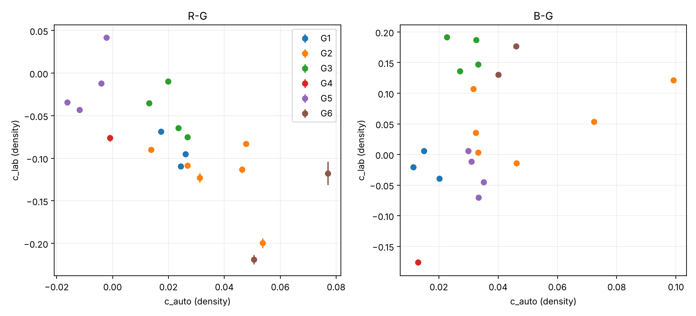
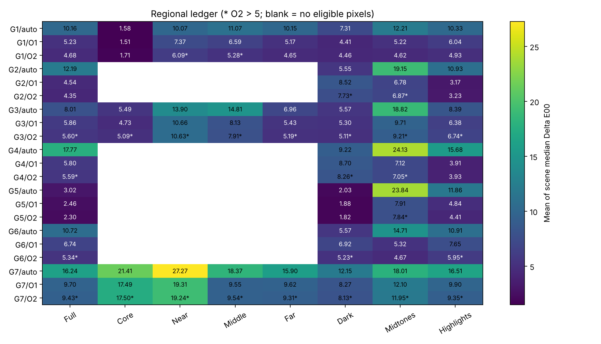

> 本报告由 `lab_timing.py --report` 依据**验收环境的完整测量**（`tools/eval/t04_result.json`）生成。验收结论与规格缺陷见 `docs/tasks/T04_ACCEPTANCE.md`：合并 k 以各自截距为准（−0.393 [−1.55, 0.44]），结论"数据不足以区分"不变。

# T04 冲印店逐帧校色力度测量

结论：**数据不足以区分**。合并 k = 0.413962。

仅作光号测量；没有更改生产参数。

| 回归 | k | 95% 下限 | 95% 上限 |
|---|---:|---:|---:|
| R | -1.814950 | -3.095949 | -1.016469 |
| B | 1.593124 | -0.098305 | 5.737480 |
| pooled | 0.413962 | -0.504111 | 1.148598 |
| K | -0.103222 | -0.674033 | 0.776186 |

格子 bootstrap 200 次；帧 bootstrap 10000 次。固定种子、成对重采样、合并回归定义见 JSON metadata.method。

| 剔除组 | kR | kB | kK |
|---|---:|---:|---:|
| 品红灯管 | -1.808564 | 1.257101 | -0.040621 |
| 夜景 | -1.678864 | 5.671013 | 0.172788 |
| 白光灯管 | -1.766736 | 2.177293 | -0.008429 |
| 色卡 | -1.909995 | 0.985233 | 0.050794 |
| 钨丝灯箱 | -1.620979 | 1.485163 | -0.300152 |
| 黄昏 | -1.935816 | 1.362687 | -0.344333 |

| 灯箱组 | 帧数 | SD 自由度 | c_lab 均值 R/B | 组内 SD R/B | c_auto 均值 R/B | 组内 SD R/B |
|---|---:|---:|---|---|---|---|
| 钨丝灯箱 | 4 | 3 | [-0.01195178371598259, -0.030298288344549715] | [0.038041773115191586, 0.033818493417803845] | [-0.008579116943609664, 0.0323674308433371] | [0.006570412491895038, 0.0023480899437379674] |
| 白光灯管 | 4 | 3 | [-0.046160909518212286, 0.16556932526050575] | [0.02947622034115762, 0.027938945176906215] | [0.020826613078882675, 0.028918999008016946] | [0.005901280978394013, 0.004952120437504911] |
| 品红灯管 | 3 | 2 | [-0.09100035710273467, -0.018078318282750513] | [0.02067850726556217, 0.022997326283135826] | [0.02263082962288465, 0.01549111121522753] | [0.004626373201640804, 0.004448562007565835] |

灯箱组实际为4 / 4 / 3帧。组内样本SD使用ddof=1；品红灯管3帧，自由度为2。

组间均值差（前组减后组，R/B）：

```json
{
  "钨丝灯箱 - 白光灯管": {
    "c_lab": [
      0.03420912580222969,
      -0.19586761360505545
    ],
    "c_auto": [
      -0.02940573002249234,
      0.0034484318353201517
    ]
  },
  "钨丝灯箱 - 品红灯管": {
    "c_lab": [
      0.07904857338675209,
      -0.012219970061799201
    ],
    "c_auto": [
      -0.031209946566494316,
      0.016876319628109565
    ]
  },
  "白光灯管 - 品红灯管": {
    "c_lab": [
      0.044839447584522386,
      0.18364764354325624
    ],
    "c_auto": [
      -0.0018042165440019763,
      0.013427887792789415
    ]
  }
}
```

散点颜色：G1=品红灯管, G2=夜景, G3=白光灯管, G4=色卡, G5=钨丝灯箱, G6=黄昏。



账本组：G1=他店日光, G2=品红灯管, G3=夜景, G4=白光灯管, G5=色卡, G6=钨丝灯箱, G7=黄昏。



| 组/阶段 | 全图 | 核心 | 近 | 中 | 远 | 暗部 | 中间调 | 亮部 |
|---|---:|---:|---:|---:|---:|---:|---:|---:|
| G1/auto | 10.163 | 1.578 | 10.073 | 11.069 | 10.153 | 7.305 | 12.214 | 10.332 |
| G1/O1 | 5.229 | 1.506 | 7.365 | 6.589 | 5.166 | 4.405 | 5.220 | 6.042 |
| G1/O2 | 4.678 | 1.715 | 6.086 **>5** | 5.279 **>5** | 4.650 | 4.462 | 4.617 | 4.934 |
| G2/auto | 12.185 | — | — | — | — | 5.548 | 19.152 | 10.934 |
| G2/O1 | 4.541 | — | — | — | — | 8.515 | 6.783 | 3.167 |
| G2/O2 | 4.351 | — | — | — | — | 7.729 **>5** | 6.874 **>5** | 3.230 |
| G3/auto | 8.005 | 5.489 | 13.895 | 14.813 | 6.959 | 5.574 | 18.818 | 8.390 |
| G3/O1 | 5.856 | 4.727 | 10.660 | 8.129 | 5.426 | 5.301 | 9.714 | 6.381 |
| G3/O2 | 5.597 **>5** | 5.086 **>5** | 10.632 **>5** | 7.915 **>5** | 5.191 **>5** | 5.108 **>5** | 9.212 **>5** | 6.736 **>5** |
| G4/auto | 17.766 | — | — | — | — | 9.221 | 24.131 | 15.678 |
| G4/O1 | 5.799 | — | — | — | — | 8.702 | 7.122 | 3.909 |
| G4/O2 | 5.591 **>5** | — | — | — | — | 8.256 **>5** | 7.048 **>5** | 3.925 |
| G5/auto | 3.020 | — | — | — | — | 2.032 | 23.835 | 11.858 |
| G5/O1 | 2.461 | — | — | — | — | 1.876 | 7.913 | 4.839 |
| G5/O2 | 2.301 | — | — | — | — | 1.821 | 7.839 **>5** | 4.408 |
| G6/auto | 10.716 | — | — | — | — | 5.567 | 14.705 | 10.913 |
| G6/O1 | 6.738 | — | — | — | — | 6.918 | 5.323 | 7.650 |
| G6/O2 | 5.342 **>5** | — | — | — | — | 5.234 **>5** | 4.672 | 5.947 **>5** |
| G7/auto | 16.243 | 21.407 | 27.272 | 18.374 | 15.904 | 12.153 | 18.011 | 16.509 |
| G7/O1 | 9.697 | 17.490 | 19.314 | 9.549 | 9.621 | 8.269 | 12.105 | 9.896 |
| G7/O2 | 9.431 **>5** | 17.498 **>5** | 19.237 **>5** | 9.543 **>5** | 9.305 **>5** | 8.128 **>5** | 11.951 **>5** | 9.349 **>5** |

触边帧（O1 任一参数距上下限 <2%）：

```json
{}
```

完整逐场景、阶段、区域 ΔE/ΔL/Δa/Δb 与光号在结果 JSON 中。未运行 accept_t04.py；独立验收仍由 Claude 执行。
