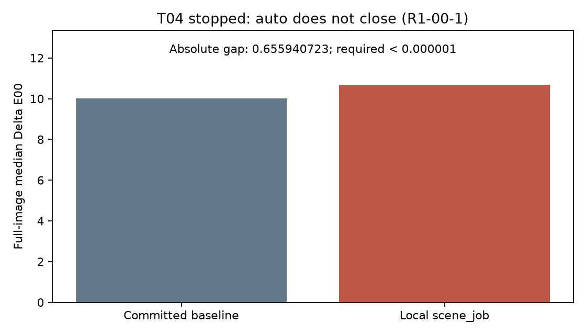
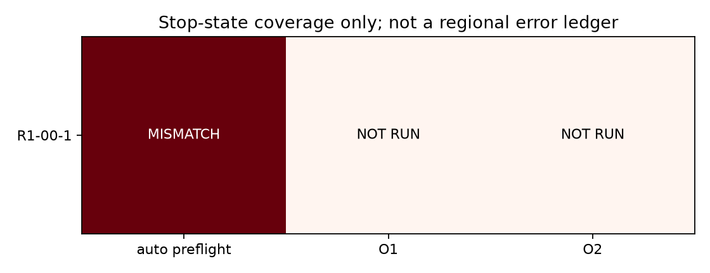

# T04 冲印店逐帧校色力度：前置闭合失败，按规则停止

基线：`a43c2af1162eff92f72513ed0d349e9cae6a2235`，分支 `codex/t04-lab-timing`。**T04测量未完成；没有k估计、置信区间或冲印店校色结论。**

## 停止事件

按固定TRAIN∪HOLDOUT顺序，第一场景 `R1-00-1` 直接调用 `accept_t02.scene_job(({}, sid))`，未另写渲染、配准、自动定光或ΔE计算：

| 项目 | 值 |
|---|---:|
| 提交基准 t03_baseline.json | 10.025349766370226 |
| 本机scene_job auto全图ΔE00中位数 | 10.681290489485985 |
| 绝对差 | 0.655940723115759 |
| 要求 | 严格小于1e-6 |

本次观察来自唯一一次真实场景前置计算（持久任务 `t04-preflight`）；它完成后即停止，没有运行其他20个场景，没有重复重渲染以寻找较接近基准的结果。原始完成事件已转录到 `tools/eval/t04_result.json` 的metadata.auto_checks。



## 已确认与未确认的原因

继续实现时，经静态源代码核对发现一个确定的**配置矛盾**，不是仅凭结果猜测环境：

| 路径 | apply 行为 | 实际 scan strength（roll=None） |
|---|---|---:|
| 生成已提交基准的 accept_t03.scene_job | 替换 accept_t02.apply，仅切换代际并返回空参数 | 0.75 |
| 规格要求的直接 accept_t02.scene_job | 原始 apply 返回 scan_color_strength=0.925 | 0.925 |

`recipe` 未覆盖该字段；`Params.scan_color_strength=None` 时 Engine 使用 `Variation.scan_strength`，标称值为0.75。T03的包装绕过T02原始apply，因此两条配置路径确实不同。这是源码可以确认的差异，**尚未重渲染，不能声称已解释全部0.65594差值**。不自行把0.925改成0.75去凑闭合，也不改基准。


- R1-00-1的RAW与扫描SHA256均与提交的epfl_800t_manifest.csv一致。文件名、实际与预期哈希见结果JSON。
- 使用现有 `filmlab-t01-data/oracle/geo_R1-00-1.npz` 固定配准缓存；缓存SHA256为 `2dee66510ac7a8dd25d5539c204d515c3f72db7ad34c197eed48fb7714ca41b5`，未重建或更换。
- 与先前T02本机现值基准的该场景结果一致（10.681290489485985）；这支持它不是本次T04生产改动引入的问题，但不能证明它与验收方的配准和数值运行时相同。
- 提交基准只提供结果值，没有可对照的几何缓存指纹、LibRaw构建和完整运行时指纹；尚不能排除配准或环境的额外贡献；但已确认上述apply配置差异。不以“可能是环境差异”为由忽略停止规则。
- 本次Python/NumPy/SciPy/colour/rawpy/scikit-image/Pillow版本均记录于JSON；LibRaw为0.22.1。闭合测量完成后另安装Matplotlib 3.11.2用于报告绘图，未更新上述测量依赖，也未重算场景。未为匹配结果更换版本、缓存、默认值或基准。

## 未产生的测量结果

| 交付测量 | 状态 |
|---|---|
| 20帧O1、逐帧颜色/密度光号 | 未运行 |
| 每帧≥200次24px格子bootstrap | 未运行 |
| k、≥2000次帧级bootstrap、逐组剔除 | 未运行 |
| 三类灯箱组内/组间离散 | 未运行 |
| 21场景×auto/O1/O2×区域的误差账本 | 未运行 |
| 单场景/全量的x与账本数值完全一致 | 尚无法验证，未产生这些数值 |
| c_lab对c_auto散点与完整账本热图 | 无合法数据，未伪造；下图仅显示停止状态 |



结果JSON保留frames/k/lightbox/ledger空对象、verdict=null，metadata.measurement_complete=false。没有将前置失败伪装为四条科学结论中的“数据不足以区分”；四条规则只适用于完成后的k置信区间。

## 已继续完成的工具

`tools/eval/lab_timing.py` 已补全测量流程，但真实运行仍停在首次auto闭合失败，没有产生k或账本。当前实现保留规格要求的原始T02调用；等待Claude澄清配置后再决定如何合法恢复。

- **直接复用渲染与对齐**：运行原始 `accept_t02.scene_job`，用临时Python返回事件观察器读取其实际aligned RGB、几何、有效掩膜及Engine.scan的Dn和自动光号；不替换渲染函数、不注入新的随机调用，finally恢复观察器。每场景独立spawn进程。
- **O1/O2**：提取并执行 `oracle_timing.job` 原始嵌套fit的AST，原有损失、初值和边界不变。在固定24px格子密度中位数上拟合；拟合光号施加于未变形的整幅Dn，裁切、sRGB编码后按auto的同一单应性对齐，计算账本。
- **误差账本**：全图、按真实扫描L*三档、灯芯距离四档。完全复用scene_job的灯芯距离图；无灯芯时不伪造距离区域。有效像素支持与auto相同；空区域n=0，统计为null。ΔL/Δa/Δb为模拟减真实。
- **不确定度**：每帧200次成对24px格子重采样；SE为拟合光号样本SD（ddof=1）。每帧种子由固定20261025、scene CRC32和流号组成，和运行顺序无关。帧级10000次成对R/B/K重采样，百分位95%区间。合并k为R/B展开后带共同截距的OLS；逐组剔除报告kR/kB/kK。零方差重采样的斜率未定义，剔除且记录次数；原始或逐组剔除斜率未定义则停止分析，不伪造结论。
- **灯箱**：三组组内样本SD和均值，另在metadata记录每对组的均值差；咖啡店仅进入账本。
- **输出与恢复**：逐场景原子写JSON检查点，记录状态/触边。超时或执行异常保存退出原因；支持同代码、同基准、同场景列表的执行失败断点恢复。科学停止不可通过--resume绕过；不自动重开已停止测量，也不覆盖既有输出。
- **报告**：完整测量通过后，--report生成实际数据散点（组色、格子SE误差棒）、账本热图及表格，标出O2>5。当前没有合法实测数据，仍只保留上面的闭合诊断和停止状态图。

```bash
# 澄清配置并解决闭合前，不执行以下真实测量命令。
FILMLAB_DATA=… python tools/eval/lab_timing.py R1-00-1 single.json
FILMLAB_DATA=… python tools/eval/lab_timing.py full.json --report docs/T04_REPORT.md
# 仅用于执行中断，不能恢复科学停止：
FILMLAB_DATA=… python tools/eval/lab_timing.py full.json --resume
```

## 合成验证与限制

合成数据测试覆盖已知x的恢复误差<1e-6、单位换算矛盾停止、闭合失败绝不调用O1、第四帧触边停止、区域边界与有符号Lab差、空区域、固定种子、独立重算成对帧bootstrap、四条结论边界、输出检查点与执行失败恢复、真实调用返回事件捕获/恢复、报告图表生成。完整数组管线测试实际调用原始拟合器、24px格子和每帧200次bootstrap：两次同一合成场景的frame及全部账本逐值相同，已知O1/O2整幅残差<1e-6。

这证明合成路径的单场景/批量一致性；**真实场景的完全一致性仍未验证**，因为没有合法的真实O1/账本结果。报告绘图分支也已用明确的合成fixture测试，测试图保留在临时目录，没有作为实测证据上传。

全量测试：**364 passed, 3 warnings in 153.64s (0:02:33)**，退出码0。完整输出：`tools/eval/t04_test_result.json`。`filmlab/` 相对a43c2af逐字节不变，tree为 `081dac42993d4f9b8b4780d1d643421ad96c6632`；`t03_baseline.json` 同样未改。未运行或导入accept_t04.py。

## 固定场景清单的文字矛盾

只按TRAIN∪HOLDOUT的静态标签计数，钨丝灯箱4帧、白光灯管4帧、品红灯管3帧（R1-21-22、R1-23-24、R1-25-26），与规格的“各4帧”不一致。R1-20-21在现有清单/manifest里是光源未知的色卡，不能自行改成品红灯管。本实现保留固定21场景和原分组，不增加场景；此处未查看任何新图像。请Claude澄清文字，后续报告必须显示实际组大小。

## 交给Claude的澄清与验收说明

请先审查T04规格中“直接T02配置”与“T03基准逐场景闭合”的冲突：T03包装将apply替换为仅generation.use的空参数函数，得到标称scan strength=0.75；直接T02路径强制0.925。请明确应复用哪个入口/配置，不以调整基准或放宽容差消除冲突。若还需环境排查，缓存、RAW/扫描哈希和运行时已在结果JSON保留。澄清后先恢复严格auto闭合检查，任一差≥1e-6仍停止；随后才能进行真实O1/O2及bootstrap、21场景账本。最终由Claude独立运行accept_t04.py、复核单场景/全量完全一致、生产目录未改和统计结论。
